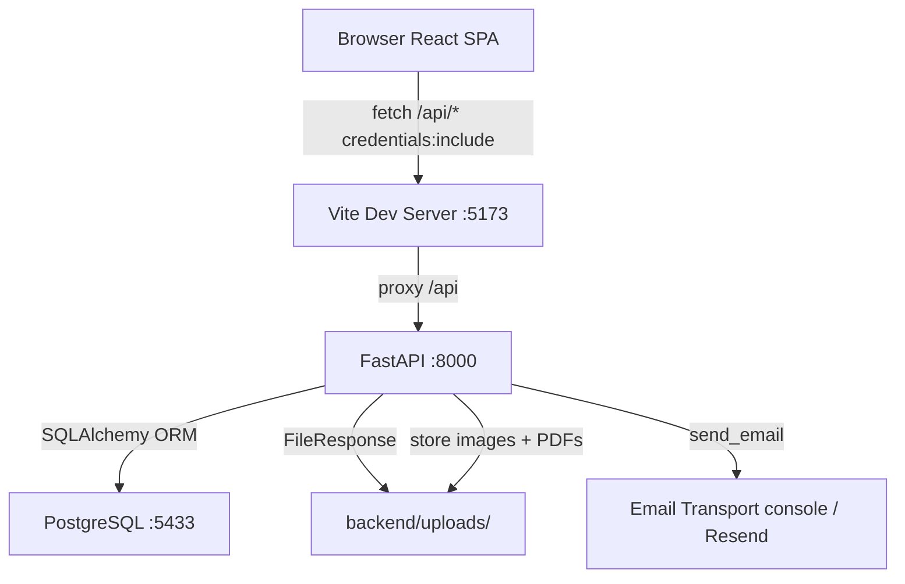

# SATYATAG — Architecture

## Overview

SATYATAG is a Legal Metrology enforcement-support system.

- **Backend**: FastAPI (Python 3.11+), SQLAlchemy 2.x ORM, Alembic migrations, PostgreSQL (port 5433 locally)
- **Frontend**: React 18, TypeScript, Vite 6, Tailwind CSS 3, React Router 6
- **Auth**: Server-side sessions (HttpOnly cookie `satyatag_session`), Argon2id password hashing
- **Email**: Resend API (production) / console log (development, `email_mode=console`)
- **PDF**: ReportLab (server-generated inspection reports)
- **Storage**: Local disk under `backend/uploads/` (evidence images + PDF reports)
- **AI/OCR**: DEMO-mode only — deterministic simulation; no real OCR/AI API currently integrated

## Data-Flow Diagram (Mermaid)



## Authentication Flow

```
Browser POST /api/auth/login
  -> Argon2id verify password
  -> Create Session row (SHA-256 token_hash only stored in DB)
  -> Set-Cookie: satyatag_session=<raw_token>; HttpOnly; SameSite=Lax
  -> Subsequent requests send cookie automatically
  -> get_current_user() hashes cookie, looks up Session row, checks expiry
```

## Database Schema Summary (24 tables)

| Table | Purpose |
|-------|--------|
| users | Accounts (email, Argon2id hash, role, status) |
| user_profiles | Extended profile (designation, phone) |
| sessions | Server-side sessions (token_hash, TTL) |
| email_verifications | OTP records (sha256 hash, attempts, cooldown) |
| password_reset_tokens | Reset tokens (sha256 hash, single-use) |
| inspections | Central inspection record |
| evidence_assets | Image metadata (unique per surface per inspection) |
| ocr_results | OCR extraction results (real CV not integrated) |
| extracted_fields | Label-value pairs extracted from label images |
| classifications | Product category classification |
| applicability_results | Which rules apply per inspection |
| compliance_checks | One check result per rule (PASS/REVIEW/VIOLATION) |
| findings | Officer-reviewable violations |
| officer_decisions | Audit row: final officer decision |
| report_metadata | PDF file references + SHA-256 checksums |
| legal_sources | Official source organisations and URLs |
| legal_documents | Acts, Rules, Amendments |
| legal_rules | Individual rules |
| legal_rule_versions | Historical versions of rules |
| legal_amendments | Amendment cross-references |
| listing_checks | Online listing URL captures |
| listing_analyses | Deterministic listing analysis results |
| notifications | User-targeted notifications |
| audit_events | Immutable audit trail |

## Directory Layout

```
demo/
  backend/
    app/
      main.py          # FastAPI app, router mounting
      config.py        # pydantic-settings (reads backend/.env)
      database.py      # SQLAlchemy engine, get_db
      auth/            # dependencies.py, security.py
      models/          # 11 ORM model files
      routers/         # 11 routers (health, auth, inspections, evidence,
      |                #   analysis, listing, legal, dashboard, notifications,
      |                #   reports, users)
      schemas/         # auth.py, inspection.py
      services/        # audit.py, notifications.py, verification.py, legal_seed.py
    scripts/           # seed_demo.py, start-db.ps1, stop-db.ps1
    tests/             # 9 pytest test files
    alembic/           # 1 migration: full 24-table schema
    uploads/           # gitignored runtime data
    .env               # Secrets (gitignored)
    .env.example
    requirements.txt
  src/
    App.tsx            # 20+ frontend routes
    context/           # AuthContext.tsx, DemoContext.tsx
    services/          # api.ts, auth.ts, inspections.ts, analysis.ts, legal.ts, platform.ts
    pages/             # 20 page components
    data/              # Local demo seed data
  vite.config.ts       # Proxy /api -> :8000
  package.json
```
